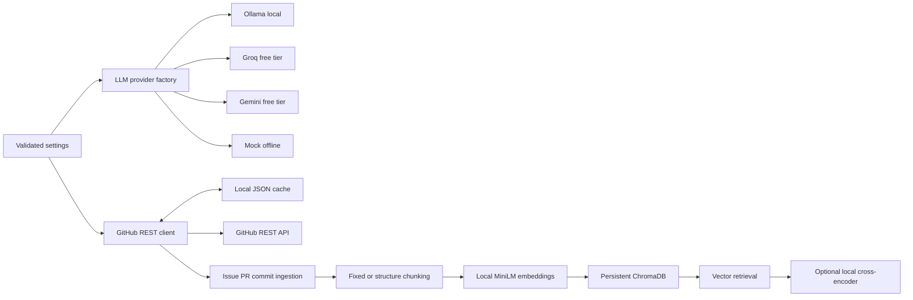

# RepoPulse

RepoPulse is a local-first project for answering questions about GitHub repositories with traceable evidence. The finished design will combine live GitHub REST data, local embeddings, a persistent vector store, a planning agent, memory, guardrails, evaluation, and traces. Development is deliberately staged so each phase can be tested and committed independently.

## Status: Phase 2 complete

The project now ingests GitHub issues, pull requests and their comments, and commits for a UTC date window. It chunks the records with fixed or structure-aware strategies, embeds them locally with `all-MiniLM-L6-v2`, and stores them in persistent ChromaDB. A local cross-encoder can rerank retrieval results. A recorded GitHub snapshot drives an offline retrieval comparison. **The agent, MCP server, memory, guardrails, full answer evaluation suite, tracing, and scripted demo are not implemented yet.**

## Quickstart

Requirements: Python 3.11+ and GNU Make. On Windows, use a Python installation with `venv` and `pip`; the Makefile uses the `py -3` launcher by default. No API key, credit card, or paid service is needed for the default local path. `make setup` installs Python packages and downloads the two free model weight sets once into `.repopulse/models`. The downloads require internet access on first setup and may take several minutes. Later inference, unit tests, and the recorded-fixture retrieval evaluation use cached weights without network access. Run `make models` to retry or refresh the model cache.

```sh
make setup
make test
make lint
make typecheck
make eval
```

For a network-free smoke check:

```sh
LLM_PROVIDER=mock .venv/bin/repopulse doctor
```

On Windows PowerShell:

```powershell
$env:LLM_PROVIDER = "mock"
.\.venv\Scripts\repopulse.exe doctor
```

The default provider is Ollama. Install Ollama separately, pull a local model such as `llama3.1:8b`, and run its local server before calling the Ollama adapter. Set `LLM_PROVIDER=groq` with `GROQ_API_KEY`, or `LLM_PROVIDER=gemini` with `GEMINI_API_KEY`, to use the optional free-tier hosted providers. The provider choice is explicit and tests use `mock` with no network. Copy `.env.example` to `.env` to customize settings. `.env` is ignored by Git.

Public GitHub reads need no token. `GITHUB_TOKEN` is optional and raises the primary REST rate limit. Cached responses are stored under `.repopulse/github-cache` by default and ignored by Git.

Ingest a live public repository, then search its local evidence:

```sh
.venv/bin/repopulse ingest pallets/click --since 2026-10-14 --until 2026-10-16 --strategy structure
.venv/bin/repopulse search "ANSI escape codes style colors" --repo pallets/click --strategy structure --rerank
```

`--since` is inclusive and `--until` is exclusive, both at midnight UTC. On Windows, use `.\.venv\Scripts\repopulse.exe` instead of `.venv/bin/repopulse`. The `ingest` command makes read-only GitHub API calls; `search` uses only local ChromaDB and cached models. Use `--strategy fixed` for the alternative collection.

The retrieval benchmark uses [recorded `pallets/click` REST fields](evals/fixtures/click_snapshot.json) and [21 labeled questions](evals/datasets/retrieval.jsonl). `make eval` regenerates [the measured report](evals/reports/retrieval_report.md) and per-query JSON. It never contacts GitHub or a hosted LLM. See [evaluation methodology](docs/EVALUATION.md) before using these numbers as evidence.

## Measured Phase 2 retrieval results

The committed report measured 21 labeled queries over 20 recorded source documents. Hit rate and MRR use the first three distinct source documents. These are results from the small curated fixture, not an estimate of performance across GitHub.

| Chunking | Reranker | Chunks | Hit rate@3 | MRR@3 |
| --- | --- | ---: | ---: | ---: |
| Fixed | Off | 85 | 1.000 | 1.000 |
| Fixed | On | 85 | 1.000 | 1.000 |
| Structure-aware | Off | 96 | 1.000 | 0.976 |
| Structure-aware | On | 96 | 1.000 | 1.000 |

The exact fixture hash, pinned model revisions, and per-query results are in the generated report and JSON. Run `make eval` after setup to reproduce the table.

## Phase roadmap

1. **Foundations:** package, config, providers, GitHub client, cache, offline tests — complete.
2. **Ingestion and retrieval:** local MiniLM embeddings, ChromaDB, two chunkers, reranking, measured retrieval evaluation — complete.
3. MCP server and LangGraph agent loop.
4. Persistent memory and storage policy.
5. Prompt-injection guardrails and citation verification.
6. Full deterministic answer evaluation suite and baseline comparisons.
7. JSONL tracing and viewer.
8. CI, polished demo, and interview documentation.

`make eval` currently runs the Phase 2 retrieval benchmark; Phase 6 will expand it to answer quality, guardrail, and ablation evaluation. `make demo` becomes functional in Phase 8. See [design decisions](docs/DESIGN.md) for the architecture and trade-offs.

## Current architecture



## Limitations

Phase 2 provides evidence search, not a synthesized repository Q&A answer. GitHub's unauthenticated primary limit is [60 requests per hour](https://docs.github.com/en/rest/using-the-rest-api/rate-limits-for-the-rest-api); fresh local cache entries avoid repeat calls and stale entries use conditional requests. The client raises a clear rate-limit exception rather than sleeping for a potentially long reset period. The Chroma cache can hold private text when using a PAT and must be treated as local private data. Hosted LLM availability and free-tier quotas are set by their providers; the local Ollama and mock paths need no hosted LLM account.
