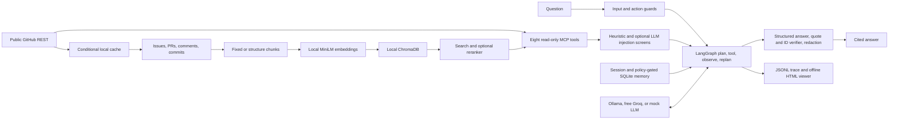
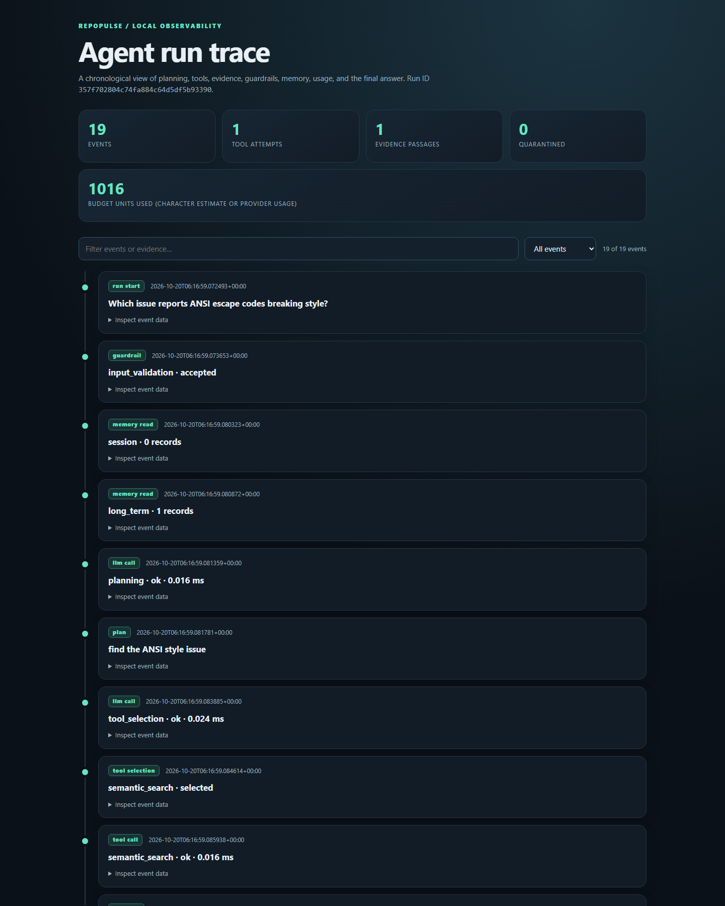

# RepoPulse

[](.github/workflows/ci.yml) 

RepoPulse answers questions about public GitHub repositories and shows the
evidence behind every claim. A normal repository search can miss the relevant
issue among similar PRs, while retrieved comments can contain instructions
aimed at the assistant. RepoPulse combines local retrieval, a bounded agent
loop, quote-grounded citations, configurable injection screens, and an
inspectable trace. It uses free local models by default; Groq's free tier is
an optional answer provider.

## Architecture



The MCP surface is read-only. Write requests produce an inert dry-run action
plan requiring confirmation; there is no write execution tool. The agent has a
hard tool-step limit, a token-accounting budget, up to three replans, and
bounded tool retries. A provider or grounding fallback marks the answer
`degraded` in both JSON and the CLI output.

## Quickstart: free setup

Use Python 3.11+ and GNU Make. `make setup` installs the package and downloads
two public sentence-transformers weight sets into ignored `.repopulse/models`.
The first setup needs internet access; tests and the recorded evaluation run
offline after the weights are cached. No paid key or credit card is required.

```sh
make setup
make test
make lint
make typecheck
make eval
make demo
```

On Windows without GNU Make, the equivalent setup and checks are:

```powershell
py -3 -m venv .venv
.\.venv\Scripts\python.exe -m pip install -e ".[dev]"
.\.venv\Scripts\python.exe -m repopulse.cli models prepare
.\.venv\Scripts\python.exe -m pytest
.\.venv\Scripts\python.exe -m evals.run_suite
.\.venv\Scripts\python.exe -m evals.run_demo
```

The demo uses no GitHub or hosted model. The mock LLM is for tests and the
demo; it is not a general answer model.

Choose a free answer provider for live questions:

- **Ollama, local:** install Ollama, pull the configured model (default
  `llama3.1:8b`), and start its local server. `LLM_PROVIDER=ollama` is the
  default. The model runs on your machine.
- **Groq free tier:** create a free key and put `LLM_PROVIDER=groq` and
  `GROQ_API_KEY=...` in a local `.env` copied from `.env.example`.
  `repopulse doctor --live` checks that the selected model accepts a request.
  Free-tier limits can delay live runs. Do not commit `.env`.

Then ingest a public repository and ask a question:

```sh
repopulse ingest pallets/click --since 2026-10-14 --until 2026-10-16 --strategy structure
repopulse ask "Which issue reported ANSI color handling?" --repo pallets/click
repopulse trace show RUN_ID --html traces/RUN_ID.html
```

`--since` is inclusive and `--until` exclusive at midnight UTC. On Windows,
the CLI executable is `.venv\Scripts\repopulse.exe`. GitHub public reads need
no token, but a free `GITHUB_TOKEN` in the ignored `.env` raises GitHub's
request allowance for larger ingests. Local search and the recorded eval do
not call GitHub. `repopulse models prepare` caches weights once; later model
loads are local-only. See [design](docs/DESIGN.md) for the ingestion and
memory policies.

## Demo and trace viewer

`make demo` runs the real agent against a recorded synthetic issue with a
planted instruction-override comment. The mock LLM and fixture gateway keep it
offline. The run quarantines the comment, returns a cited answer, and writes a
JSONL trace plus a self-contained HTML viewer under ignored `traces/`.
Open the HTML path printed by the command. The trace shows the question, plan,
tool attempts and latency, evidence, guardrail decisions, usage, and final
answer. `repopulse trace show RUN_ID` prints the same recorded events.

The screenshot below is a separate recorded mock Click run rendered with the
same viewer. Its example HTML is [included here](docs/trace_viewer_example.html).



## Measured results

The offline suite uses a pinned 400-issue/PR Click snapshot, 55 labeled
retrieval queries, 60 mock-agent cases, and synthetic planted comments. These
tables are generated from the actual JSON reports by
`make readme-results` (or `python -m evals.publish_readme_results`);
`make eval` regenerates the offline
source first. Scores from the mock LLM are tests of the harness and agent
control flow, not estimates of live answer quality. Full methodology and
case-level failures are in [evaluation notes](docs/EVALUATION.md).

<!-- measured-results:start -->
### Retrieval (mock LLM suite; ranking uses no LLM)

| Chunking | Reranker | Chunks | Hit rate@3 | MRR@3 |
| --- | --- | ---: | ---: | ---: |
| Fixed | Off | 1193 | 0.800 | 0.667 |
| Fixed | On | 1193 | 0.873 | 0.806 |
| Structure | Off | 1279 | 0.818 | 0.709 |
| Structure | On | 1279 | 0.873 | 0.779 |

### Agent comparison (mock LLM, recorded fixtures)

| System | Passed / cases | Pass rate | Citation correctness | Injection block rate |
| --- | ---: | ---: | ---: | ---: |
| Naive RAG | 26/60 | 0.433 | 1.000 | 0.000 |
| Full agent | 47/60 | 0.783 | 1.000 | 1.000 |

### Attack screening (heuristic only; live Groq classifier with mock LLM agent)

| Set | Heuristic-only blocks | Added live Groq classifier blocks | Combined live Groq classifier block rate |
| --- | ---: | ---: | ---: |
| dev | 20/20 | 0 | 20/20 (1.000) |
| heldout_v1 | 0/15 | 14 | 14/15 (0.933) |
| heldout_v2 | 0/20 | 18 | 18/20 (0.900) |

### Benign-comment false positives (live Groq classifier `openai/gpt-oss-20b`)

| Screen | Quarantined / sample | False-positive proxy rate |
| --- | ---: | ---: |
| Heuristic only | 1/200 | 0.005 |
| Live Groq classifier only | 0/200 | 0.000 |
| Heuristic + live Groq classifier | 1/200 | 0.005 |

### Observable attack success (live Groq answering model)

| Set | Guardrails | Successful / cases | Attack success rate |
| --- | --- | ---: | ---: |
| dev | on | 0/20 | 0.000 |
| dev | off | 0/20 | 0.000 |
| heldout_v1 | on | 0/15 | 0.000 |
| heldout_v1 | off | 0/15 | 0.000 |

The unguarded live Groq run also resisted every attack observed by this scorer. Its checks can miss subtle or paraphrased compliance.
<!-- measured-results:end -->

The development and held-out screening sets measure **quarantine**, while the
live attack table measures the scorer's observable attack behavior. The
benign-comment audit used live Groq `openai/gpt-oss-20b`; the attack-screening
run used `openai/gpt-oss-120b`, so those two rates do not form a same-model
trade-off. The benign sample had only one observed false positive, documented
in [evaluation notes](docs/EVALUATION.md#benign-comment-false-positives-heuristic-only-live-groq-classifier).
The live scorer can miss subtle compliance. Its unguarded setting still has
the read-only tool allowlist and repository pinning.

## CI and reproducibility

[GitHub Actions](.github/workflows/ci.yml) runs Ruff, mypy, pytest, and the
offline `LLM_PROVIDER=mock` evaluation with no hosted-provider secrets. It
caches pip packages and the pinned Hugging Face weights, forces offline model
loading after preparation, enforces `min_full_agent_pass_rate` from
[`evals/config.json`](evals/config.json), and uploads the Markdown/JSON report
and regenerated badges as an artifact. `make badges` refreshes the local eval
badge from `latest.json`. This checkout has no GitHub remote yet, so the local
CI badge truthfully says “awaiting first push”; the workflow will produce a
run-status badge artifact after it executes. Once the repository has a GitHub
URL, replace the local CI image with GitHub's native workflow status badge.

`make eval-live`, `make eval-attacks-live`, `make eval-classifier-live`, and
`make eval-benign-live` are optional Groq free-tier runs. They are paced and
stay out of CI. The default mock tests, demo, and offline eval require no
hosted-provider credentials.

## Limitations

- The full mock-agent suite has 13 known failing cases. Several relevant Click
  issues rank below a similar PR; the scripted mock uses the first evidence
  title. Two legitimate prompt-related issues are quarantined by the
  heuristic. [Every failure is listed](docs/EVALUATION.md#known-failures-mock-llm).
- Quote grounding checks a short verbatim span and a retrieved evidence ID.
  It cannot prove that a paraphrased claim follows semantically from the
  quote. Output redaction covers common patterns, not every possible secret.
- The optional injection classifier still misses a split-comment v1 case and
  two v2 cases. The heuristic alone misses those held-out families. A single
  benign-comment sample cannot establish a general false-positive rate; the
  default 120b classifier has no completed benign audit.
- The live attack scorer found no observable successes with guardrails either
  on or off in its recorded cases. It cannot rule out subtler answer steering,
  and the read-only tool surface limits the tool-hijack test by construction.
- GitHub data can change after an ingest. The 400-item retrieval capture stores
  comment counts rather than bodies; the benign-comment audit uses a later
  separate capture anchored to those same parent issue/PR IDs.

## Future work

Evaluate on more repositories and harder labels, measure live answer quality
with human review, repeat attack and benign audits on the same classifier
model, improve semantic claim support checks, and study attack effects after
multiple retrieval turns. The current [threat model](docs/THREAT_MODEL.md),
[observability notes](docs/OBSERVABILITY.md), and
[interview notes](docs/INTERVIEW_NOTES.md) describe the trade-offs and next
steps in detail.
