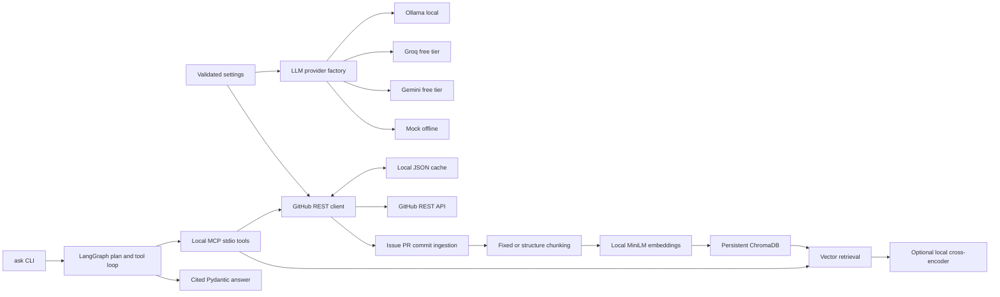

# RepoPulse

RepoPulse is a local-first project for answering questions about GitHub repositories with traceable evidence. The finished design will combine live GitHub REST data, local embeddings, a persistent vector store, a planning agent, memory, guardrails, evaluation, and traces. Development is deliberately staged so each phase can be tested and committed independently.

## Status: Phase 3 complete

The project ingests GitHub issues, pull requests, comments, and commits into local ChromaDB, then answers repository questions with a LangGraph agent using eight read-only MCP tools. The agent replans when evidence is insufficient, retries tool failures with backoff, stops at configured step and token budgets, and returns a Pydantic answer with citations on every claim. A recorded GitHub snapshot drives offline tests and retrieval evaluation. **Memory, full prompt-injection guardrails, the answer evaluation suite, tracing, and the scripted demo are scheduled for later phases.**

## Quickstart

Requirements: Python 3.11+ and GNU Make. On Windows, use a Python installation with `venv` and `pip`; the Makefile uses the `py -3` launcher by default. No API key, credit card, or paid service is needed for the default local path. `make setup` installs Python packages and downloads the two free model weight sets once into `.repopulse/models`. The downloads require internet access on first setup and may take several minutes. Later inference, unit tests, and the recorded-fixture retrieval evaluation use cached weights without network access. Run `make models` to retry or refresh the model cache.

```sh
make setup
make test
make lint
make typecheck
make eval
```

For a network-free smoke check:

```sh
LLM_PROVIDER=mock .venv/bin/repopulse doctor
```

On Windows PowerShell:

```powershell
$env:LLM_PROVIDER = "mock"
.\.venv\Scripts\repopulse.exe doctor
```

The default provider is Ollama. Install Ollama separately, pull a local model such as `llama3.1:8b`, and run its local server before calling the Ollama adapter. Set `LLM_PROVIDER=groq` with `GROQ_API_KEY`, or `LLM_PROVIDER=gemini` with `GEMINI_API_KEY`, to use the optional free-tier hosted providers. The Groq default is `openai/gpt-oss-120b`, which [Groq lists on its free plan](https://console.groq.com/docs/rate-limits); its former `llama-3.3-70b-versatile` default [was retired for free-tier use](https://console.groq.com/docs/deprecations). The provider choice is explicit and tests use `mock` with no network. Copy `.env.example` to `.env` to customize settings. `.env` is ignored by Git.

Ask a question after `make setup`; local semantic search uses the cached embedding model and an ingested collection, while the other tools read public GitHub REST endpoints through the cache:

```sh
.venv/bin/repopulse ask "Which issue reported ANSI color handling?" --repo pallets/click
.venv/bin/repopulse ask "Which changes affect styling?" --repo pallets/click --max-steps 8 --token-budget 8000
```

On Windows, use `.\.venv\Scripts\repopulse.exe`. The command starts the bundled MCP server over stdio, loads the cached embedding model once before accepting tool calls, and prints progress to stderr while it plans and searches. The first `ask` in a new process can take tens of seconds while Python loads the local model; it does not download weights. Each MCP tool call has a 60-second timeout. A timed-out tool is retried within the step limit, and the answer includes a limitation if it still fails. The command prints validated, ASCII-safe JSON with `summary`, `key_changes`, `risks`, and `limitations`. Each claim has a `citations` array containing retrieved issue, PR, or commit URLs. For direct issue-identification questions, cited issues must also contain key terms from the question. If no matching citable source is found, the claim fields remain empty and `limitations` explains why. You can run the standalone server with `python -m repopulse.mcp_server` from the virtual environment.

The default Ollama path is local and free. `LLM_PROVIDER=mock` is a network-free deterministic smoke path; it can produce a cited source title when evidence is available, but it is not a meaningful natural-language answer. GitHub REST calls from `ask` still need connectivity unless responses are cached. Unit tests use the recorded fixture and a mock LLM, with no GitHub or model download requests. The sentence-transformers weights are fetched once by `make setup`/`make models` and then loaded from `.repopulse/models` in local-only mode; tests do not load them.

Public GitHub reads need no token. [GitHub allows 60 unauthenticated REST requests per hour and generally 5,000 per hour with a personal access token](https://docs.github.com/en/rest/using-the-rest-api/rate-limits-for-the-rest-api). A GitHub token is free and separate from the Groq API key. For a larger ingest window, put `GITHUB_TOKEN=...` in the local Git-ignored `.env` to raise the limit. Keep using the read-only public-repository scope you need. Cached responses are stored under `.repopulse/github-cache` by default and ignored by Git.

Ingest a live public repository, then search its local evidence:

```sh
.venv/bin/repopulse ingest pallets/click --since 2026-10-14 --until 2026-10-16 --strategy structure
.venv/bin/repopulse search "ANSI escape codes style colors" --repo pallets/click --strategy structure --rerank
```

`--since` is inclusive and `--until` is exclusive, both at midnight UTC. On Windows, use `.\.venv\Scripts\repopulse.exe` instead of `.venv/bin/repopulse`. The `ingest` command makes read-only GitHub API calls; `search` uses only local ChromaDB and cached models. Use `--strategy fixed` for the alternative collection.

Ingestion now fetches discussion and review comments through GitHub's repository-wide `since` endpoints and groups them by issue or PR, avoiding a comment request per item. It uses the PR title and body already present in GitHub's issue listing, avoiding a PR detail request per item. Paginated listings still require calls. If a run reaches GitHub's rate limit, RepoPulse prints the reset delay and exits without writing an incomplete corpus; rerun it after the reset or configure a free `GITHUB_TOKEN` in `.env`. The Groq key does not affect GitHub's request quota.

The retrieval benchmark uses [recorded `pallets/click` REST fields](evals/fixtures/click_snapshot.json) and [21 labeled questions](evals/datasets/retrieval.jsonl). `make eval` regenerates [the measured report](evals/reports/retrieval_report.md) and per-query JSON. It never contacts GitHub or a hosted LLM. See [evaluation methodology](docs/EVALUATION.md) before using these numbers as evidence.

## Measured Phase 2 retrieval results

The committed report measured 21 labeled queries over 20 recorded source documents. Hit rate and MRR use the first three distinct source documents. These are results from the small curated fixture, not an estimate of performance across GitHub.

| Chunking | Reranker | Chunks | Hit rate@3 | MRR@3 |
| --- | --- | ---: | ---: | ---: |
| Fixed | Off | 85 | 1.000 | 1.000 |
| Fixed | On | 85 | 1.000 | 1.000 |
| Structure-aware | Off | 96 | 1.000 | 0.976 |
| Structure-aware | On | 96 | 1.000 | 1.000 |

The exact fixture hash, pinned model revisions, and per-query results are in the generated report and JSON. Run `make eval` after setup to reproduce the table.

## Phase roadmap

1. **Foundations:** package, config, providers, GitHub client, cache, offline tests — complete.
2. **Ingestion and retrieval:** local MiniLM embeddings, ChromaDB, two chunkers, reranking, measured retrieval evaluation — complete.
3. **MCP server and LangGraph agent loop** — complete.
4. Persistent memory and storage policy.
5. Prompt-injection guardrails and citation verification.
6. Full deterministic answer evaluation suite and baseline comparisons.
7. JSONL tracing and viewer.
8. CI, polished demo, and interview documentation.

`make eval` currently runs the Phase 2 retrieval benchmark; Phase 6 will expand it to answer quality, guardrail, ablation, and harder retrieval evaluation. `make demo` becomes functional in Phase 8. See [design decisions](docs/DESIGN.md) for the architecture and trade-offs.

## Current architecture



## Limitations

The agent's token budget uses a documented character-based reservation when the provider cannot report token usage, plus the provider's reported usage when available. It caps each requested completion and stops further calls at the budget, but exact tokenization varies by provider. Phase 5 will add claim-level evidence support checks and injection defenses; Phase 3 verifies that every retained citation URL came from retrieved evidence. GitHub's unauthenticated primary limit is [60 requests per hour](https://docs.github.com/en/rest/using-the-rest-api/rate-limits-for-the-rest-api); fresh local cache entries avoid repeat calls and stale entries use conditional requests. The Chroma cache can hold private text when using a PAT and must be treated as local private data.
