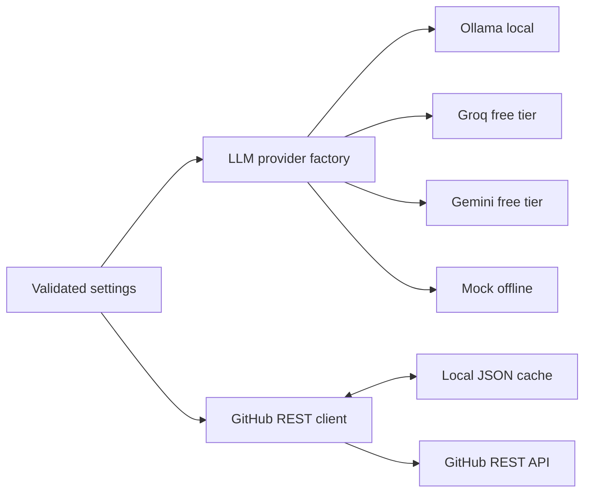

# RepoPulse

RepoPulse is a local-first project for answering questions about GitHub repositories with traceable evidence. The finished design will combine live GitHub REST data, local embeddings, a persistent vector store, a planning agent, memory, guardrails, evaluation, and traces. Development is deliberately staged so each phase can be tested and committed independently.

## Status: Phase 1 complete

This commit provides the Python package, validated configuration, four interchangeable LLM providers, a read-only GitHub REST client, an on-disk HTTP cache, and offline unit tests. **The agent, RAG pipeline, memory, MCP server, evaluation suite, and demo are not implemented yet.** `make eval` and `make demo` currently print their planned phase. No quality or accuracy metrics are claimed.

## Quickstart

Requirements: Python 3.11+ and GNU Make. On Windows, use a Python installation with `venv` and `pip`; the Makefile uses the `py -3` launcher by default. No API key, credit card, or paid service is needed for the default local path.

```sh
make setup
make test
make lint
make typecheck
```

For a network-free smoke check:

```sh
LLM_PROVIDER=mock .venv/bin/repopulse doctor
```

On Windows PowerShell:

```powershell
$env:LLM_PROVIDER = "mock"
.\.venv\Scripts\repopulse.exe doctor
```

The default provider is Ollama. Install Ollama separately, pull a local model such as `llama3.1:8b`, and run its local server before calling the Ollama adapter. Set `LLM_PROVIDER=groq` with `GROQ_API_KEY`, or `LLM_PROVIDER=gemini` with `GEMINI_API_KEY`, to use the optional free-tier hosted providers. The provider choice is explicit and tests use `mock` with no network. Copy `.env.example` to `.env` to customize settings. `.env` is ignored by Git.

Public GitHub reads need no token. `GITHUB_TOKEN` is optional and raises the primary REST rate limit. Cached responses are stored under `.repopulse/github-cache` by default and ignored by Git.

## Phase roadmap

1. **Foundations:** package, config, providers, GitHub client, cache, offline tests — complete.
2. Ingestion and retrieval with measured retrieval evaluation.
3. MCP server and LangGraph agent loop.
4. Persistent memory and storage policy.
5. Prompt-injection guardrails and citation verification.
6. Deterministic evaluation suite and baseline comparisons.
7. JSONL tracing and viewer.
8. CI, polished demo, and interview documentation.

`make eval` and `make demo` become functional in Phases 6 and 8 respectively. See [design decisions](docs/DESIGN.md) for the architecture and Phase 1 trade-offs.

## Current architecture



## Limitations

Phase 1 exposes transport and configuration primitives, not a user-facing repository Q&A command. GitHub's unauthenticated primary limit is [60 requests per hour](https://docs.github.com/en/rest/using-the-rest-api/rate-limits-for-the-rest-api); fresh local cache entries avoid repeat calls and stale entries use conditional requests. The current client raises a clear rate-limit exception rather than sleeping for a potentially long reset period. Hosted LLM availability and free-tier quotas are set by their providers; the local Ollama and mock paths need no hosted LLM account.
